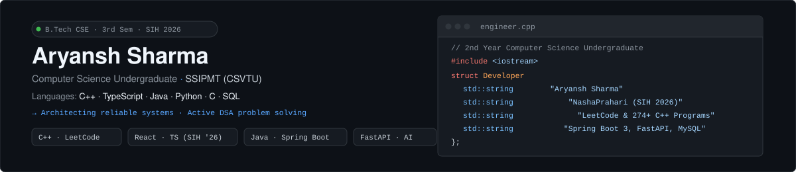
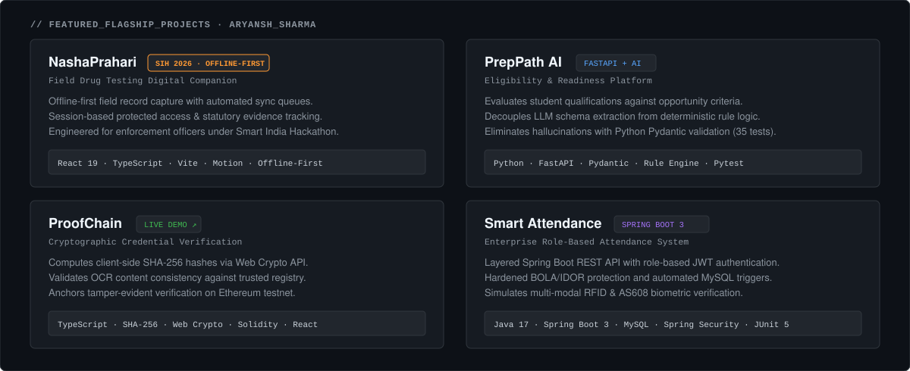

  

    

  
  
  
  

---

### 👨‍💻 About Me

> **Computer Science undergraduate building resilient full-stack architectures, solving complex algorithmic challenges in C++, and engineering mission-critical systems.**

I'm a 3rd-Semester B.Tech Computer Science & Engineering student at SSIPMT Raipur (CSVTU). My technical focus spans across offline-first web architecture (lead developer of **NashaPrahari** for Smart India Hackathon 2026), structured enterprise backends in Java Spring Boot and FastAPI, rigorous algorithmic problem solving on LeetCode with automated CI pipelines, and verifiable systems programming in modern C++.

---

### 🏛️ Core Identity Pillars

| 1. Full-Stack &amp; Offline Systems | 2. Advanced DSA &amp; Systems | 3. Enterprise Backend | 4. Applied AI &amp; Security |
|:---|:---|:---|:---|
| • Offline-First PWA Architectures • React 19 &amp; TypeScript Ecosystem • Session Authorization &amp; Protected Routes • Field Officer UX (SIH 2026) | • Modern C++ (274 Programs / 20 Modules) • LeetCode Problem Solving (Easy/Med/Hard) • Automated Syncode CI Synchronization • Graph Traversal, DP &amp; Backtracking | • Layered REST API Architecture • Java 17 + Spring Boot 3 &amp; JPA • Relational Schema Design &amp; MySQL • Hardened BOLA/IDOR &amp; JWT RBAC | • Decoupled AI Pipeline Design • Strict Pydantic Schema Validation • Client-Side SHA-256 Web Crypto • Sepolia Ethereum Smart Contracts |

---

### 🛠️ Skills & Technologies

| Category | Technologies &amp; Tools |
|---|---|
| **Core Languages** | `C++` &nbsp;•&nbsp; `TypeScript` &nbsp;•&nbsp; `Java` &nbsp;•&nbsp; `Python` &nbsp;•&nbsp; `C` &nbsp;•&nbsp; `SQL` &nbsp;•&nbsp; `Solidity` |
| **Frontend &amp; Offline** | `React 19` &nbsp;•&nbsp; `TypeScript` &nbsp;•&nbsp; `Vite` &nbsp;•&nbsp; `Motion (Framer)` &nbsp;•&nbsp; `HTML5` &nbsp;•&nbsp; `CSS3 / Responsive Design` |
| **Backend &amp; Databases** | `Spring Boot 3` &nbsp;•&nbsp; `FastAPI` &nbsp;•&nbsp; `MySQL 8.0` &nbsp;•&nbsp; `Spring Security (JWT)` &nbsp;•&nbsp; `Spring Data JPA` &nbsp;•&nbsp; `Supabase` |
| **Testing &amp; CI/CD** | `Pytest` &nbsp;•&nbsp; `JUnit 5` &nbsp;•&nbsp; `GitHub Actions` &nbsp;•&nbsp; `Syncode CI` &nbsp;•&nbsp; `Git` &nbsp;•&nbsp; `VS Code` &nbsp;•&nbsp; `GCC / Clang` |

---

### 🚀 Featured Projects

  

 

| Project | Description | Tech Stack | Links |
|:---|:---|:---|:---:|
| **[NashaPrahari](https://github.com/aryanshsharma2025-max/nashaprahari)** | **Offline-first digital companion for field drug testing engineered for Smart India Hackathon (SIH 2026).** Features offline test record capture, local sync queue management, evidence locker tracking, session-based role authorization, and statutory enforcement design. | `React 19` `TypeScript` `Vite` `Motion` `Offline-First` |  |
| **[PrepPath AI](https://github.com/aryanshsharma2025-max/PrepPath-AI)** | Opportunity-to-application readiness platform. Decouples Gemini schema extraction from a deterministic Python rule engine to evaluate applicant eligibility without hallucinations. Backed by 35 Pytest unit and integration tests. | `Python` `FastAPI` `Pydantic` `Rule Engine` `Pytest` |  |
| **[ProofChain](https://github.com/aryanshsharma2025-max/ProofChain)** | Decentralized credential integrity and verification system. Computes SHA-256 hashes in-browser via Web Crypto API, performs OCR consistency checking against trusted registry metadata, and anchors verification on Ethereum testnet. | `TypeScript` `SHA-256` `Solidity` `React` `Supabase` |     |
| **[Smart Attendance](https://github.com/aryanshsharma2025-max/Smart-Attendance)** | Attendance management system with canonical Spring Boot 3 backend and MySQL 8.0 schema. Features role-based JWT authentication (HOD/Faculty/Student), BOLA/IDOR authorization protection, 252 student accounts, and JUnit 5 test suites. | `Java 17` `Spring Boot 3` `MySQL` `Spring Security` `JUnit 5` |  |
| **[cpp-practice](https://github.com/aryanshsharma2025-max/cpp-practice)** | Structured C++ practice repository featuring **274 verified programs across 20 modules** (Basics, Control Flow, Strings, Pointers, Structures, File Handling, Searching, Sorting, Bitwise, OOP, STL, DSA, Mini Projects) with automated GCC CI verification. | `C++` `OOP` `Data Structures` `GCC CI` `GitHub Actions` |  |
| **[Portfolio Website](https://github.com/aryanshsharma2025-max/Portfolio)** | Personal developer portfolio built with semantic HTML5, modern CSS3 (Syne/DM Mono typography, dark/light theme persistence in localStorage), and vanilla ES6+ JavaScript with zero build overhead. | `HTML5` `CSS3` `JavaScript` `Responsive Design` |  |
| **[SAAP (Academic Analytics)](https://github.com/aryanshsharma2025-max/Success_Academic_Analytics_Platform)** | System architecture and design specifications for an institutional academic analytics platform. Features IEEE SRS v1.0 specifications, 9-role RBAC design, 13-entity relational ERD schema, and validated 6,991-record synthetic dataset. | `System Design` `IEEE SRS` `ERD / SQL` `Python Validator` |  |

---

### 💻 Problem Solving & Algorithmic Practice

- **[DSA_Questions (LeetCode Solutions)](https://github.com/aryanshsharma2025-max/DSA_Questions)** — Continuous algorithmic problem solving in C++ with automated Syncode synchronization. 28+ verified solutions across Easy, Medium (Number of Islands, Number of Provinces, Permutations, Combination Sum, Rotate List), and Hard (N-Queens, Median of Two Sorted Arrays).
- **[cpp-practice (274 Programs)](https://github.com/aryanshsharma2025-max/cpp-practice)** — Exhaustive 20-module C++ collection covering OOP encapsulation, inheritance, polymorphism, templates, memory management, and data structures with automated GCC compilation tests.
- **[Web Development Lab Coursework](https://github.com/aryanshsharma2025-max/Web-Dev)** — 229 practical lab files covering HTML5 form validation, DOM manipulation, keyboard/mouse event handling, and interactive layouts.
- **[Competitive Programming (CP-geeks)](https://github.com/aryanshsharma2025-max/CP-geeks)** — C++ contest solutions on Codeforces focusing on monotonic predicates and binary search on answer techniques ($O(n \log(\text{range}))$).
- **[C Programming (1st Sem)](https://github.com/aryanshsharma2025-max/C-programs--college-)** — 116 verified programs covering pointers, memory addresses, dynamic allocation (`malloc`, `calloc`, `free`), structs, and file streams.
- **[Python Practice (2nd Sem)](https://github.com/aryanshsharma2025-max/Python-Programs)** — 87 coursework scripts covering core Python syntax, recursion, exception handling, file streams, and introductory data analysis with NumPy.

---

### 📫 Get In Touch

  **Open to software engineering internships, technical mentorship, and systems/backend collaborations.**

   

  
  &nbsp;&nbsp;
  
  &nbsp;&nbsp;
  

    
  © 2026 Aryansh Sharma • Computer Science & Engineering Undergraduate

