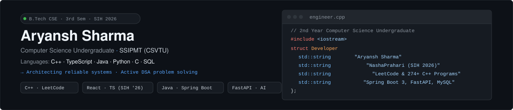
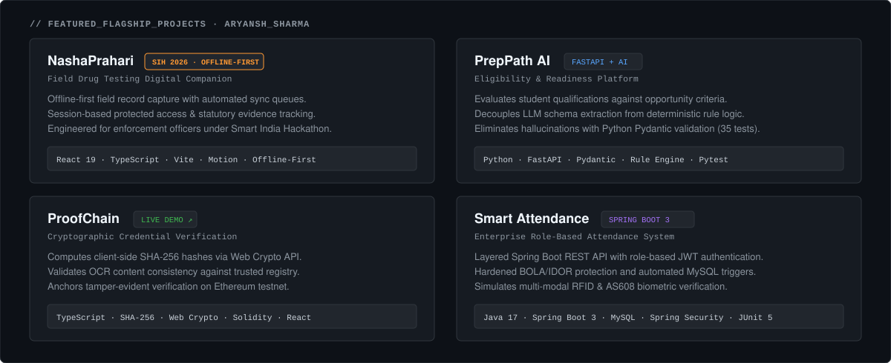

  

    

  
  
  
  

---

### 👨‍💻 About Me

> **Computer Science & Engineering undergraduate focusing on robust backend systems, deterministic rule engines, relational database architecture, and algorithmic problem solving.**

I am a 3rd-Semester B.Tech Computer Science & Engineering student at SSIPMT Raipur (CSVTU). My technical focus centers on:
- **Backend & REST APIs:** Engineering layered services in Java 17 / Spring Boot 3 and Python / FastAPI.
- **Applied AI & Deterministic Validation:** Decoupling non-deterministic LLM extraction (Google Gemini) from deterministic business logic with Pydantic schemas and Python rule engines.
- **Relational Systems & Design:** Modeling 3NF relational schemas, authorization matrices, and automated integrity validation tooling in MySQL and Python.
- **Systems Fundamentals & DSA:** Writing modern C++ and solving algorithmic challenges on LeetCode and GeeksforGeeks.

---

### 🏛️ Technical Focus Areas

| 1. Enterprise Backend | 2. Applied AI & Rules | 3. Security & Hashing | 4. Algorithms & C++ |
|:---|:---|:---|:---|
| • Java 17 + Spring Boot 3 • Spring Security 6 & JWT • Relational Schema Design (MySQL) • Authorization boundary testing (BOLA/IDOR) | • Python 3.12 & FastAPI • Pydantic v2 data contracts • Deterministic Python rule engines • Automated Pytest suites (39 tests) | • Client-side SHA-256 (Web Crypto) • Solidity smart contracts (`^0.8.28`) • Hardhat & Viem test suites (8 tests) • Heuristic OCR consistency checks | • Modern C++ (C++17) • 246 modular coursework programs • 34 algorithmic solutions (LeetCode/GFG) • Graphs, Backtracking, Two-Pointers |

---

### 🛠️ Languages & Tools

| Category | Technologies & Tools |
|---|---|
| **Programming Languages** | `C++` &nbsp;•&nbsp; `Java` &nbsp;•&nbsp; `Python` &nbsp;•&nbsp; `TypeScript` &nbsp;•&nbsp; `C` &nbsp;•&nbsp; `SQL` &nbsp;•&nbsp; `Solidity` |
| **Backend & Databases** | `Spring Boot 3` &nbsp;•&nbsp; `FastAPI` &nbsp;•&nbsp; `MySQL 8.0` &nbsp;•&nbsp; `Spring Data JPA` &nbsp;•&nbsp; `Pydantic v2` &nbsp;•&nbsp; `Hibernate` |
| **Frontend & Web** | `React` &nbsp;•&nbsp; `TypeScript` &nbsp;•&nbsp; `Vite` &nbsp;•&nbsp; `HTML5` &nbsp;•&nbsp; `CSS3` &nbsp;•&nbsp; `Vanilla JavaScript` |
| **Testing & CI/CD** | `Pytest` &nbsp;•&nbsp; `JUnit 5` &nbsp;•&nbsp; `Hardhat` &nbsp;•&nbsp; `GitHub Actions` &nbsp;•&nbsp; `Maven` &nbsp;•&nbsp; `GCC / G++` |

---

### 🚀 Featured Engineering Projects

  

 

| Project | Focus | Architecture & Engineering Highlights | Links |
|:---|:---|:---|:---:|
| **[PrepPath AI](https://github.com/aryanshsharma2025-max/PrepPath-AI)** | **Backend & Rule Engine** | Decouples Gemini schema extraction from a deterministic Python rule engine to eliminate AI hallucinations in scholarship assessment. Backed by **39 passing Pytest tests** covering edge cases, income cleaning, and upload limits. |  |
| **[ProofChain](https://github.com/aryanshsharma2025-max/ProofChain)** | **Document Integrity & Web3** | Multi-layer credential verification combining in-browser SHA-256 Web Crypto hashing, OCR consistency checks, and a Solidity smart contract anchored on EVM ledgers. Verified with **8 Hardhat tests**. |     |
| **[Smart Attendance](https://github.com/aryanshsharma2025-max/Smart-Attendance)** | **Enterprise Java Backend** | Layered Spring Boot 3 architecture with MySQL 8.0 schema and stateless JWT authentication. Implements role-based access control (HOD/Faculty/Student) and BOLA/IDOR protection verified across **3 JUnit 5 test suites**. |  |
| **[SAAP](https://github.com/aryanshsharma2025-max/Success_Academic_Analytics_Platform)** | **Systems Design & Data Modeling** | Institutional academic analytics specifications including IEEE SRS v1.0, 9-role authorization matrix, 13-entity relational ERD (3NF), and a **6,991-record synthetic dataset** verified by an automated Python integrity validator. |  |
| **[NashaPrahari](https://github.com/aryanshsharma2025-max/nashaprahari)** | **Frontend Prototype (SIH 2026)** | Field-oriented digital companion prototype for narcotics testing operations. Explores responsive mobile interfaces, step-by-step screening workflows, and digital custody tracking in React 19 and TypeScript. |  |
| **[Portfolio Website](https://github.com/aryanshsharma2025-max/Portfolio)** | **Vanilla Web Engineering** | Personal developer portfolio engineered with semantic HTML5, modern CSS3 variables (dark/light theme persistence in `localStorage`), and vanilla JavaScript with zero framework dependencies. |     |

---

### 💻 Problem Solving & Algorithmic Practice

- **[DSA_Questions](https://github.com/aryanshsharma2025-max/DSA_Questions)** — **34 solved algorithmic problems** in modern C++ across LeetCode (31) and GeeksforGeeks (3). Includes solutions in graph traversal (Number of Islands, Number of Provinces, Bipartite Graph, Course Schedule, Directed Cycle), backtracking (N-Queens, Permutations, Combination Sum), and dynamic programming.
- **[cpp-practice](https://github.com/aryanshsharma2025-max/cpp-practice)** — **246 verified C++ programs across 12 active modules** (and 3 roadmap directories) covering language fundamentals, pointers, memory addressing, OOP (constructors, encapsulation, inheritance, polymorphism), and elementary data structures.
- **[C Programming (1st Sem)](https://github.com/aryanshsharma2025-max/C-programs--college-)** — **116 verified programs** covering dynamic memory allocation (`malloc`, `calloc`, `free`), pointers, structs, and file streams.
- **[Python Coursework (2nd Sem)](https://github.com/aryanshsharma2025-max/Python-Programs)** — **87 coursework scripts** covering Python syntax, recursion, exception handling, and NumPy computations.
- **[Web Development Lab](https://github.com/aryanshsharma2025-max/Web-Dev)** — **191 practical lab exercises** exploring semantic HTML, form validation, CSS layouts, and DOM event handling.

> **Audit & Integrity Note:** All program and solution counts are audited directly via Git-tracked source files (`git ls-files`), explicitly excluding untracked build artifacts, virtual environments, and generated dependencies.

---

### 📫 Contact & Connect

  **Open to software engineering internships, technical mentorship, and systems/backend development.**

   

  
  &nbsp;&nbsp;
  
  &nbsp;&nbsp;
  

    
  © 2026 Aryansh Sharma • B.Tech Computer Science & Engineering Undergraduate

